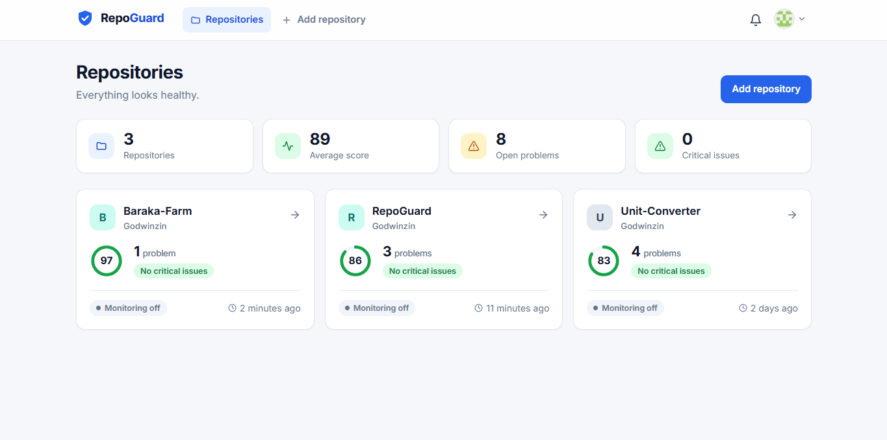
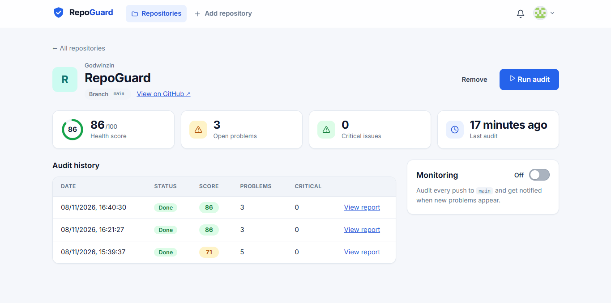
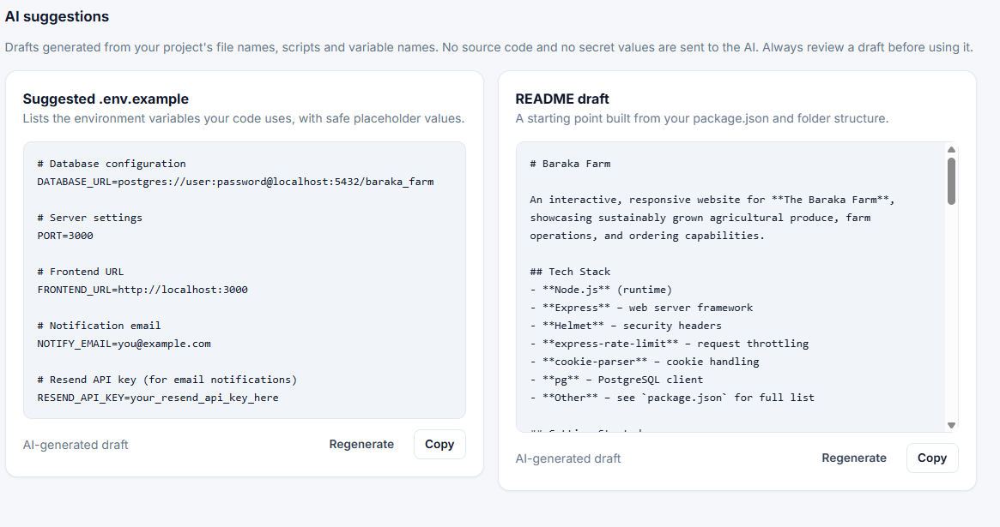
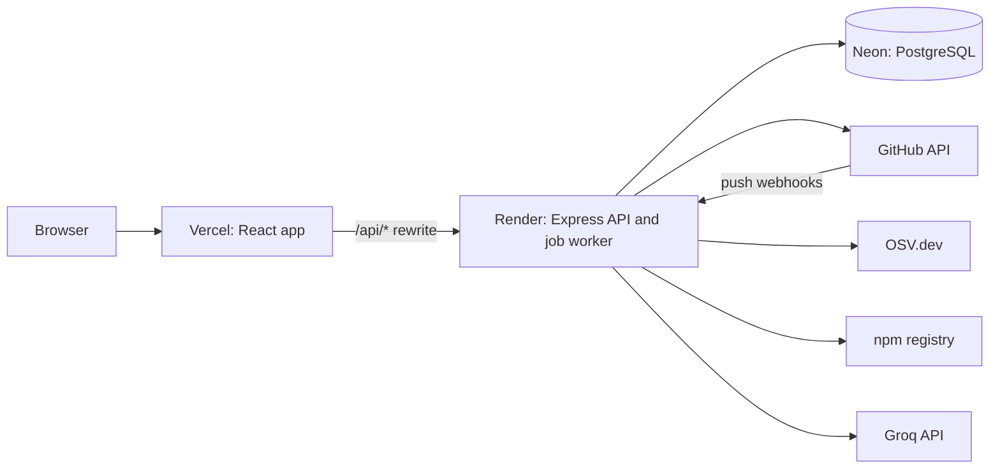

# RepoGuard


**A health checker for GitHub repositories.** Connect your GitHub account, pick a repository, and RepoGuard audits it for committed secrets, vulnerable dependencies, missing documentation and weak project structure. Every problem comes with a plain-English explanation of why it matters and how to fix it. Turn on monitoring and it re-audits on every push and tells you when something new appears.

**Live demo:** https:///repoguardtech.vercel.app

> The demo runs on free hosting tiers, so the first request after a quiet period can take about a minute while the backend wakes up. See [Known limitations](#known-limitations).

## Table of contents

- [Features](#features)
- [Screenshots](#screenshots)
- [How an audit works](#how-an-audit-works)
- [Architecture](#architecture)
- [Tech stack](#tech-stack)
- [Security design](#security-design)
- [Project structure](#project-structure)
- [Getting started](#getting-started)
- [Environment variables](#environment-variables)
- [API reference](#api-reference)
- [Database schema](#database-schema)
- [Deployment](#deployment)
- [Known limitations](#known-limitations)
- [Roadmap](#roadmap)
- [Contributing](#contributing)
- [License](#license)

## Features

- **GitHub login** with OAuth. RepoGuard never sees your password.
- **Repository audits** that run in the background, with live progress on the report page.
- **A health score (0 to 100)** and findings grouped by severity: critical, high, medium, low, info.
- **Actionable findings.** Each one explains why it matters and how to fix it.
- **Comparison between audits.** Findings are labelled new or unchanged, and problems that disappeared are listed as fixed, with the score change.
- **Dependency analysis.** Known vulnerabilities (via OSV.dev) and dependencies that are a major version behind (via the npm registry).
- **Secret scanning** for cloud keys, tokens, private keys, passwords in connection strings and other hardcoded secrets. RepoGuard stores only the file, line and type, never the secret itself.
- **Automatic monitoring.** A GitHub webhook triggers a new audit on every push to the default branch, and you get an in-app notification when new problems appear.
- **AI suggestions** for a missing `.env.example` and a README draft, built only from names and structure. No source code and no secret values are sent to the AI provider.
- **A responsive dashboard** with skeleton loaders, friendly error messages, toasts, a notification bell and automatic light and dark mode.

## Screenshots

| Dashboard | Report |
| --- | --- |
|  |  |

| Repository page | AI suggestions |
| --- | --- |
|  |  |

## How an audit works

1. The user clicks **Run audit** (or pushes code to a monitored repository).
2. The API records a `queued` audit and adds a job to a PostgreSQL-backed queue, then answers immediately with `202 Accepted`.
3. A worker picks up the job, decrypts the user's GitHub token, and fetches the repository's **file list** through the GitHub API. File contents are only fetched when a rule needs them. Repositories are never cloned and no repository code is ever run.
4. Every rule runs in parallel against a shared context. Each rule returns zero or more findings.
5. The score is calculated, and the findings and final status are saved in a single database transaction.
6. For push-triggered audits, the new findings are compared with the previous audit by **fingerprint** and a notification is created if anything is new.

An audit that takes longer than two minutes is cancelled: an `AbortController` aborts every request it has in flight, and the audit is marked failed with a clear message.

### Scoring

The score starts at 100 and loses points per finding: **critical 25, high 15, medium 8, low 3, info 0**. The minimum is 0.

### Fingerprints

Each finding has a stable fingerprint built from the rule, the file and, where relevant, the package or secret ID (for example `vulnerable-dependency:client/package-lock.json:vite@8.3.2`). Fingerprints are how two audits are compared: in both means unchanged, only in the new one means new, only in the old one means fixed.

### Rules

| Rule | Severity | What it checks |
| --- | --- | --- |
| `env-committed` | critical | A `.env` file is committed to the repository |
| `secret-detected` | critical, high or medium | A hardcoded secret: AWS, GitHub, Stripe, Slack and Google keys, AI provider keys, private keys, passwords in connection strings, and high-entropy secret-like assignments |
| `vulnerable-dependency` | by advisory | A package in `package-lock.json` has known vulnerabilities (OSV.dev) |
| `node-modules-committed` | high | `node_modules` is committed |
| `readme-missing`, `gitignore-missing`, `lockfile-missing`, `tests-missing` | medium | Missing README, `.gitignore`, lockfile, or automated tests |
| `env-example-missing`, `license-missing`, `ci-missing` | low | Missing `.env.example`, license, or CI configuration |
| `readme-too-short`, `readme-no-install`, `readme-no-run`, `readme-no-env` | low | The README is too short, or doesn't explain installing, running, or the environment variables |
| `dependencies-outdated` | low | Direct dependencies that are a major version behind |
| Notices | info | The dependency scan was skipped or failed, or the secret scan was partial |

Monorepos are supported: every `package.json` is checked next to its own lockfile.

## Architecture



**Key design decisions**

- **One origin for the browser.** Vercel forwards `/api/*` to the backend, so the session cookie is first-party and never blocked as a third-party cookie.
- **A queue inside PostgreSQL** (pg-boss) instead of a separate service such as Redis. Jobs survive restarts, and handlers are idempotent because jobs can be delivered more than once.
- **Rules are small independent objects** with one interface. Adding a check means adding one object to a list.
- **The audit is deterministic.** AI is only used afterwards, for optional suggestions.
- **Pure logic is kept separate from I/O** (comparison, secret scanning, signature verification, output sanitising), so it is easy to unit test.

## Tech stack

| Layer | Technology |
| --- | --- |
| Frontend | React (Vite), React Router, plain CSS with design tokens |
| Backend | Node.js 24, Express |
| Database | PostgreSQL (Neon) |
| Job queue | pg-boss |
| Auth and sessions | GitHub OAuth, `express-session`, `connect-pg-simple` |
| Hardening | `helmet`, `express-rate-limit`, AES-256-GCM, HMAC-SHA256 |
| External data | GitHub REST API, OSV.dev, npm registry |
| AI suggestions | Groq (chat completions, model set in `AI_MODEL`) |
| Hosting | Vercel (frontend), Render (backend), Neon (database) |

## Security design

- **OAuth** uses a random `state` value (CSRF protection), and the session ID is regenerated after login (session fixation protection).
- **Sessions** are stored server-side in PostgreSQL. The cookie is `HttpOnly`, `SameSite=Lax`, and `Secure` in production.
- **GitHub tokens are encrypted at rest** with AES-256-GCM and a random IV per value. Tokens are never logged and are never put in job payloads: jobs carry only an ID.
- **Webhooks are authenticated** with an HMAC-SHA256 signature computed over the raw request body and compared in constant time. Each delivery ID is stored with a unique constraint, so redeliveries are ignored.
- **Authorization on every query.** Every user-owned query is filtered by the session's user ID. Nested resources (audits, findings, recommendations) are checked through their parent repository.
- **Secrets found in repositories are never stored.** Only the file, line and type are saved, plus a short keyed HMAC used to tell "the same secret as last time" from "a new one".
- **AI data minimisation.** Only validated variable names, dependency names, script names (with inline values removed), folder names and secret-checked text are sent. Model output is validated against known facts, size-limited and secret-scanned. It is displayed as plain text, never as HTML.
- **Repository content is treated as untrusted input.** Package names are validated before being used in URLs, and findings render as text.
- **Rate limiting** applies to login attempts (per IP), audits and monitoring changes (per user), and AI generation (a daily quota per user).
- **Every outbound request has a timeout**, and audits propagate cancellation to in-flight requests.
- **Request logs** record the path only (never the query string, which holds OAuth codes) and no personal data.

## Project structure

```text
repoguard/
├── client/
│   ├── public/favicon.svg
│   ├── vercel.json                  # /api proxy and single-page-app fallback
│   └── src/
│       ├── api.js                   # fetch wrapper with friendly error messages
│       ├── useApi.js, useAudit.js, useRecommendations.js
│       ├── auth/                    # AuthContext, AuthProvider, useAuth
│       ├── toast/                   # ToastContext, ToastProvider, useToast
│       ├── components/              # Layout, NotificationBell, ScoreRing, Skeleton, ...
│       └── pages/                   # Login, Dashboard, AddRepos, RepoDetail, Report
└── server/
    └── src/
        ├── ai/                      # client, projectFacts, prompts, sanitize, recommend
        ├── audit/
        │   ├── rules/               # structure, project, readme, dependencies, secrets
        │   ├── compare.js           # new / unchanged / fixed (pure function)
        │   ├── secretScanner.js     # pattern and entropy scanner (pure function)
        │   ├── runAudit.js, request.js, report.js, notify.js, context.js, helpers.js
        ├── config/env.js            # validates configuration at startup
        ├── db/                      # pool, migrate, migrations/*.sql
        ├── jobs/queue.js            # pg-boss queues and workers
        ├── middleware/              # requireAuth, rateLimits, requestLogger
        ├── routes/                  # auth, repos, audits, monitoring, notifications, ...
        ├── services/                # github, osv, npm
        └── utils/                   # crypto, webhookSignature
```

## Getting started

### Prerequisites

- Node.js 24
- A PostgreSQL database. A free [Neon](https://neon.tech) project works well. Use the **direct** connection string (connection pooling off), because pg-boss needs it.
- A GitHub account to create an OAuth app
- Optional: a [Groq](https://console.groq.com) API key for AI suggestions

### 1. Clone and install

```bash
git clone https://github.com/Godwinzin/repoguard.git
cd repoguard

cd server && npm install
cd ../client && npm install
```

### 2. Create a GitHub OAuth app

GitHub, then **Settings, Developer settings, OAuth Apps, New OAuth App**:

- Homepage URL: `http://localhost:5173`
- Authorization callback URL: `http://localhost:4000/auth/github/callback`

Copy the client ID and generate a client secret.

### 3. Configure the server

Copy `server/.env.example` to `server/.env` and fill it in (see [Environment variables](#environment-variables)). Generate each secret with:

```bash
node -e "console.log(require('crypto').randomBytes(32).toString('hex'))"
```

Put each setting on its own line. Make sure the file ends with a newline, so two settings never get glued together.

### 4. Create the tables and start both servers

```bash
cd server
npm run migrate
npm run dev
```

In a second terminal:

```bash
cd client
npm run dev
```

Open http://localhost:5173. The Vite dev server proxies `/api` to the Express server on port 4000.

### 5. Optional: monitoring in development

GitHub can't reach `localhost`, so use a tunnel:

```bash
cloudflared tunnel --url http://localhost:4000
```

Set `PUBLIC_URL` in `server/.env` to the address it prints (no trailing slash) and restart the server. Then turn on **Monitoring** for a repository you own. Quick tunnel addresses change every time you restart them, so turn monitoring off and on again after that.

### Tests

```bash
cd server
npm test
```

Uses Node's built-in test runner. The tests cover the pure logic: audit comparison, the secret scanner, webhook signature verification, AI output sanitising and environment-variable extraction.

## Environment variables

All of these go in `server/.env` (or the host's environment settings in production).

| Variable | Required | Description |
| --- | --- | --- |
| `PORT` | no | Port to listen on (default 4000; hosts usually set it) |
| `NODE_ENV` | in production | Set to `production` to enable secure cookies and proxy trust |
| `DATABASE_URL` | yes | PostgreSQL direct connection string, ending in `?sslmode=verify-full` |
| `CLIENT_URL` | yes | Where the frontend is served from (used for redirects after login) |
| `GITHUB_CLIENT_ID` | yes | OAuth app client ID |
| `GITHUB_CLIENT_SECRET` | yes | OAuth app client secret |
| `GITHUB_CALLBACK_URL` | yes | OAuth callback URL. It must exactly match the one registered with GitHub |
| `SESSION_SECRET` | yes | Random value used to sign session cookies |
| `TOKEN_ENCRYPTION_KEY` | yes | 64 hex characters (32 bytes), used to encrypt GitHub tokens |
| `WEBHOOK_SECRET` | yes | Random value shared with GitHub to sign webhooks |
| `PUBLIC_URL` | for monitoring | Publicly reachable address of the **API** (no trailing slash) |
| `GROQ_API_KEY` | for AI | Enables AI suggestions. Without it they are disabled |
| `AI_MODEL` | for AI | Model name, for example `openai/gpt-oss-120b` |
| `TRUST_PROXY` | in production | Number of proxies in front of the API (default 1) |

Use **different** secrets, a different OAuth app and a different database for development and production.

## API reference

All routes except `/health`, `/auth/*` and `/webhooks/*` require a session cookie. Errors return `{ "error": "..." }`, and some include a human-readable `message`.

| Method | Path | Description |
| --- | --- | --- |
| GET | `/health` | Liveness and database check |
| GET | `/auth/github` | Start the GitHub login |
| GET | `/auth/github/callback` | OAuth callback (redirects to the frontend) |
| GET | `/auth/me` | The current user |
| POST | `/auth/logout` | End the session |
| GET | `/repos/github` | Your public GitHub repositories, flagged if already added |
| GET | `/repos` | Added repositories with their latest score and problem counts |
| GET | `/repos/:id` | One repository |
| POST | `/repos` | Add a repository: `{ "githubRepoId": 123 }` |
| DELETE | `/repos/:id` | Remove a repository (also removes its webhook) |
| POST | `/repos/:id/audits` | Request an audit (`202`); returns the running one if there is one |
| GET | `/repos/:id/audits` | Audit history |
| GET | `/audits/:id` | Full report with findings and the comparison to the previous audit |
| POST | `/repos/:id/monitoring` | Enable monitoring (creates the GitHub webhook) |
| DELETE | `/repos/:id/monitoring` | Disable monitoring |
| POST | `/webhooks/github` | GitHub webhook receiver (signature-verified) |
| POST | `/audits/:id/recommendations` | Generate `env_example` or `readme` |
| GET | `/audits/:id/recommendations` | Generated suggestions and their status |
| GET | `/notifications` | Latest notifications |
| POST | `/notifications/read-all` | Mark all as read |
| POST | `/notifications/:id/read` | Mark one as read |
| DELETE | `/notifications` | Delete all notifications |
| DELETE | `/notifications/:id` | Delete one notification |

## Database schema

Migrations live in `server/src/db/migrations` and run in order with `npm run migrate`. Each applied file is recorded in `schema_migrations`.

| Table | Purpose |
| --- | --- |
| `users` | A RepoGuard user |
| `github_accounts` | Linked GitHub account, with the encrypted token and granted scopes |
| `repositories` | Repositories a user added, with monitoring state and webhook ID |
| `audits` | One audit run: status, score, commit, who triggered it, any error |
| `audit_findings` | Findings of an audit, with severity, fix text and fingerprint |
| `recommendations` | AI-generated drafts (`env_example`, `readme`) and their status |
| `ai_usage` | One row per AI request, used for daily quotas |
| `webhook_events` | Every webhook delivery (unique delivery ID) and what was done with it |
| `notifications` | In-app notifications |
| `session` | Server-side sessions |
| `schema_migrations` | Applied migrations |
| `pgboss.*` | The job queue's own schema, managed by pg-boss |

A partial unique index guarantees a repository has at most one queued or running audit at a time.

## Deployment

The production setup is **Vercel** (frontend), **Render** (backend) and **Neon** (database).

1. **Database.** In Neon, create a separate database for production and copy its direct connection string.
2. **Backend on Render.** A Web Service with root directory `server`, build command `npm ci`, start command `npm run migrate:deploy && npm start`, and health check path `/health`. Add every variable from the table above, with `NODE_ENV=production`.
3. **Frontend on Vercel.** A project with root directory `client`. Put the backend address in `client/vercel.json`, which forwards `/api/*` and provides the single-page-app fallback.
4. **A production GitHub OAuth app** whose callback is `https:///repoguardtech.vercel.app/api/auth/github/callback`. The callback uses the **frontend** address so the session cookie is first-party.
5. **`PUBLIC_URL`** is the backend's own address, so GitHub's webhooks reach it directly.
6. **`TRUST_PROXY`** must match the real number of proxies between the internet and the API. Verify it by checking that the IP your server sees is your real one.

## Known limitations

- **Free hosting sleeps.** The backend spins down after inactivity and takes about a minute to wake. While it is asleep nothing runs, and a webhook that arrives then may fail (use **Redeliver** in GitHub's webhook settings).
- **Public repositories only.** Private repositories need a GitHub App.
- **JavaScript and Node projects only.**
- **The vulnerability scan reads `package-lock.json`** (npm 7 and newer). Yarn and pnpm lockfiles are reported as skipped.
- **Only the default branch is audited**, and secret scanning covers current files rather than Git history, capped at 150 files per audit.
- **The notification bell polls once a minute.** There is no real-time push, and no email yet.
- **Rate-limit counters live in memory,** so they reset when the server restarts.
- **One shared webhook secret** is used for all repositories.

## Roadmap

- [ ] GitHub App with private repository support
- [ ] Yarn and pnpm lockfiles, and other languages
- [ ] Mark development-only dependencies and pick the fixed version for the user's release line
- [ ] Email notifications
- [ ] Per-repository webhook secrets
- [ ] Route-level and end-to-end tests
- [ ] Server-Sent Events instead of polling

## Contributing

Issues and pull requests are welcome. Please run `npm test` in `server` and `npm run build` in `client` before opening one, and keep pure logic (for example comparison and scanning) free of database and network code so it stays testable.

## License

Released under the [MIT License](LICENSE).